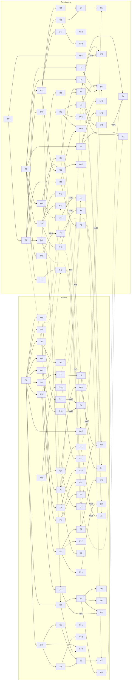

# 39 — Melhorias incrementais e formigueiro de dependências

Documento novo do projeto, criado em 2026-10-19 a pedido do desenvolvedor. **Aprovado pelo desenvolvedor em 2026-10-19: níveis repetíveis e os valores sugeridos da planilha.** Os valores ainda não foram testados em jogo e nada foi construído. Os números (custos, crescimento, efeito por nível, tetos) ficam na planilha [39_Melhorias_incrementais_valores.xlsx](../04_Data/39_Melhorias_incrementais_valores.xlsx); quando este texto e a planilha divergirem num número, vale a planilha.

[Índice da documentação](../README.md)

> Este documento **amplia** as seções 17 a 28. Ele não as substitui: os nós já descritos nelas (P0, T0, C0–C4, B0–B3, D0–D2, R0–R1, Q0–Q2, O0–O3, L0–L3, F0–F1, E0–E2, J0–J2, N0–N2, S0–S3) continuam com o mesmo id, efeito e custo. A regra da seção 28 ("uma compra por nó, sem níveis infinitos") foi revista pelo desenvolvedor em 2026-10-19: níveis repetíveis passam a valer, como descrito aqui. Registro em [Production/GAME_DESIGN.md](../../Production/GAME_DESIGN.md).

## Objetivo

Transformar a evolução da colônia num incremental: sempre existe algo para comprar com nutrientes (N), cada compra muda algo perceptível na simulação e as compras se puxam umas às outras pelo jogo inteiro. O jogador deve olhar a tela de evolução e ver um **formigueiro sendo escavado**, não uma lista de botões.

## Três camadas de progressão

| Camada | O que é | Como se compra | Exemplo |
|---|---|---|---|
| **Câmara** (nó único) | Desbloqueio qualitativo: uma classe, uma sala, uma mecânica nova | Uma vez | L0 libera a carregadora; G1 dobra a água de cada gota |
| **Galeria** (nó com nível) | Melhoria numérica repetível, presa a uma câmara | Nível a nível, preço crescente | O+1: comuns +4% de velocidade por nível |
| **Marco** | Recompensa automática ao atingir certos níveis de uma galeria | Não se compra; acontece | C+1 no nível 25: canteiro novo já brota com 1 nutriente pronto |

**Ideia futura, fora deste documento: prestígio pela revoada nupcial.** Uma rainha nova sai em revoada, funda outra colônia e leva "genética" que dá bônus permanentes. Só registrada; não detalhar nem prever espaço na árvore até ser pedida.

## O padrão formigueiro

As duas abas da tela Evolução (Formigueiro e Rainha e classes) usam o **mesmo padrão visual e de regras**, inspirado na referência `22-arvore-formigueiro-radial.png` que a tela já segue:

- **Câmara central.** A raiz da aba: a câmara real (aba Formigueiro, com P0 e T0) ou a rainha (aba Rainha, com Q0). Tudo parte dela.
- **Ramos são túneis radiais.** Cada ramo sai do centro numa direção (8 ramos por aba). Quanto mais longe do centro, mais profundo, mais caro e mais forte.
- **Anéis de profundidade.** Os nós ficam em quatro anéis (A1 a A4). Um anel só se abre quando a colônia tem **profundidade** suficiente (ver abaixo); antes disso ele aparece como terra ainda não escavada.
- **Câmaras e galerias.** Câmaras (losango, como hoje) ficam no eixo do túnel. Galerias (forma de câmara lateral, com o selo de nível) brotam ao lado da câmara de que dependem, como as galerias laterais de um formigueiro real.
- **Túneis são dependências.** Cada linha entre dois nós é um requisito. Há quatro tipos de túnel, todos desenhados de forma distinta:

| Túnel | Requisito | Desenho sugerido |
|---|---|---|
| Simples | Nó comprado | Linha contínua (como hoje) |
| De nível | Galeria num nível mínimo ("C+1 Nv 5") | Linha com o número do nível no meio |
| Cruzado | Nó da **outra aba** | Linha que termina numa abertura na borda da tela, com o ícone do nó da outra aba; clicar leva até ele |
| De junção | Dois ou mais nós ao mesmo tempo ("exige X e Y") | Linhas que se encontram numa câmara maior |

- **Condições do mundo.** Alguns nós também pedem algo que acontece no jogo, não na árvore: primeiro ataque de cupins vencido (já existe para S0), número de ataques vencidos, adultas vivas. Aparecem como um selo no nó.

### Regras de dependência

1. Todo nó novo tem pelo menos um requisito; só a câmara central não tem.
2. Toda **câmara nova** do anel 3 ou 4 tem pelo menos **um túnel cruzado, de nível ou condição do mundo** (os nós das seções 17 a 28 mantêm os requisitos do design revisado, com os cruzados acrescentados abaixo, e as galerias ficam presas à câmara de que dependem): é isso que espalha as dependências pelo jogo inteiro e faz a evolução de uma aba puxar a outra.
3. Nenhum requisito circular, nem entre abas.
4. Requisito com "e" exige todos; não existe "ou" (escolhas do design, como C2/C3 e B1/B2, continuam sendo ramos paralelos que se juntam depois).

### Profundidade da colônia

Contador único das duas abas: **1 por câmara comprada (as iniciais não contam) + 1 por nível de galeria comprado + 3 por galeria com teto completada.** Ele abre os anéis:

| Anel | Profundidade exigida | Papel |
|---|---|---|
| A1 | 0 | Básico: o que existe no começo |
| A2 | 5 | Especialização dos ramos |
| A3 | 20 | Integração entre ramos (túneis cruzados) |
| A4 | 50 | Câmaras profundas: mudanças grandes, só com a colônia madura |

A profundidade aparece no topo da tela Evolução, ao lado do saldo de N, e a terra dos anéis fechados vai clareando conforme ela se aproxima do próximo limite.

## Galerias: níveis, custo e efeito

### Tipos

| Tipo | Usado em | Teto | Crescimento do custo (r) |
|---|---|---|---|
| **Físico** | Velocidade, carga, tempo de tarefa, capacidade por célula, aberturas | Sempre tem teto | 1,35 por nível |
| **Economia** | Rendimento de nutrientes, crescimento de plantas e canteiros | Infinito | 1,15 por nível |
| **Combate** | Dano e vida dos soldados | Infinito (os ataques também crescem) | 1,22 por nível |

O teto existe nos atributos físicos porque a simulação é em pixels: formiga rápida demais pula células e quebra o pathfinding; carga ou capacidade demais deixa de ser legível. Os multiplicadores de economia podem crescer sem fim, e é deles que vem a sensação de incremental.

### Fórmulas

- **Custo do nível n** (o próximo a comprar, n ≥ 1): `custo base × r^(n − 1)`, arredondado para inteiro.
- **Galeria física**: bônus = `efeito por nível × n`, com n limitado ao teto. Reduções de tempo usam `tempo × (1 − bônus)`; os tetos foram escolhidos para nenhuma redução passar de 50%.
- **Galeria de economia ou combate**: bônus = `efeito por nível × n × 1,5^⌊n / 10⌋`. A cada 10 níveis o bônus da própria galeria é multiplicado por 1,5 (marco de multiplicador).

### Como os bônus se somam (regra da seção 28, mantida)

- Os níveis de uma mesma galeria somam entre si.
- A galeria multiplica o valor **depois** das câmaras do mesmo atributo. Ex.: O2 troca a velocidade das comuns de 24 para 30 células/s; O+1 no nível 5 dá +20% sobre 30.
- Fontes diferentes só multiplicam quando o texto declara. Neste documento, as declaradas são: O+1 × X+2 (velocidade fora do formigueiro), L+2 × X+2, Q+2 × N3 (custo da cria) e B+1 × B1/B2 (tempos de larva e pupa).
- **O custo de cada cria continua fixo** (seção 29): nada aqui cobra mais por nascimento. As reduções (Q+2, N3) somadas ficam limitadas a −40%.

### Marcos

| Marco | Vale para | Efeito |
|---|---|---|
| Nv 10, 20, 30… | Economia e combate | Bônus da galeria × 1,5 (já incluído na fórmula) |
| Nv 25 | Economia e combate | Mudança qualitativa própria da galeria (tabela das galerias) |
| Teto atingido | Físico | Galeria "completa": desenho de câmara cheia e +3 de profundidade |

Todo marco é um evento de juice (seção 35): som próprio, a câmara lateral se alarga na tela e um aviso curto no HUD.

## Aba Formigueiro

Câmara central: **câmara real** (P0 Postura e T0 Túnel comum, iniciais). Oito ramos.

### Câmaras

| Id | Nome | Anel | Requisitos | Efeito | Situação |
|---|---|---|---|---|---|
| P0 | Postura | Centro | — | Sala da rainha | Inicial (seção 17) |
| T0 | Túnel comum | Centro | — | Túneis genéricos | Inicial (seção 17) |
| C0 | Cultivo inicial | A1 | P0 | Sala de nutrientes (canteiros) | Seção 18; hoje é pincel livre → nó inicial |
| C1 | Canteiros organizados | A1 | C0 | Seção 18 | Seção 18 |
| C2 | Área de preparo | A2 | C1 | Seção 18 | Seção 18 |
| C3 | Cultivo produtivo | A2 | C1 | Seção 18 | Seção 18 |
| C4 | Cultivo integrado | A3 | C2 e C3 | Seção 18 | Seção 18 |
| **C5** | Jardim da rainha | A4 | C4 e J+1 Nv 10 | Nutriente pronto a até 12 células da rainha conta direto no saldo, sem transporte | Novo |
| B0 | Berçário inicial | A1 | C0 | Seção 19 | Seção 19 |
| B1 | Leitos de criação | A2 | B0 | Seção 19 | Seção 19 |
| B2 | Área de maturação | A2 | B0 | Seção 19 | Seção 19 |
| B3 | Berçário organizado | A3 | B1 e B2 | Seção 19 | Seção 19 |
| **B4** | Ninhada gêmea | A4 | B3, Q2 e B+1 Nv 5 | 10% dos ovos viram duas larvas (paga uma cria; exige vaga para as duas) | Novo |
| D0 | Depósito de alimentos | A1 | C0 | Seção 20 | Seção 20; hoje é pincel livre → ver migração |
| **D3** | Depósito de construção | A1 | T0 | Pincel do depósito de construção | Existe no jogo como pincel livre → ver migração |
| **D4** | Depósito de água | A1 | T0 | Pincel do depósito de água | Existe no jogo como pincel livre → ver migração |
| D1 | Pilhas organizadas | A2 | D0 | Seção 20 | Seção 20 |
| D2 | Cargas grandes | A3 | D1 e L1 | Seção 20 (o L1 cruzado é novo: sem carga maior, guardar peça grande não tem uso) | Seção 20 + requisito novo |
| **D5** | Logística integrada | A4 | D2, D3, D4 e L2 | Formigas ociosas levam itens entre depósitos do mesmo tipo para o mais perto de quem consome | Novo |
| R0 | Área de resíduos | A1 | C0 | Seção 21; hoje é pincel livre → nó inicial | Seção 21 |
| R1 | Decomposição acelerada | A2 | R0 | Seção 21 | Seção 21 |
| **G0** | Sala Gotas de orvalho | A1 | T0 | Pincel da sala de orvalho | Existe no jogo como pincel livre → nó inicial |
| **G1** | Folhas coletoras | A2 | G0 e C1 | Cada gota vale 2 células de água | Novo |
| **G2** | Neblina do amanhecer | A3 | G+1 Nv 10 e J+2 Nv 5 | As gotas também caem nos canteiros vizinhos da sala (rega sem transporte) | Novo |
| **T1** | Despejo organizado | A1 | T0 | Aberturas de despejo 4 → 6 | Novo |
| **T2** | Rotas batidas | A3 | T+1 Nv 5 e O2 | Túneis com muito tráfego viram trilha: +10% de velocidade dentro do formigueiro | Novo |
| **X0** | Trilha de forrageio | A1 | T0 | +10% de velocidade fora do formigueiro | Novo |
| **X1** | Jardim cultivado | A3 | X+1 Nv 10 e J1 | Plantas cortadas perto da entrada rebrotam no mesmo lugar | Novo |
| **M0** | Entradas vigiadas | A2 | T0 e primeiro ataque vencido | Aviso de ataque 8 → 12 s | Novo |
| **M1** | Câmara de refúgio | A3 | M0, B3, N2 e 5 ataques vencidos | Pincel de refúgio: no aviso, crias e cuidadoras vão para lá | Novo |

### Galerias

| Id | Nome | Anel | Requisitos | Atributo (base no jogo) | Por nível | Tipo e teto | Marco Nv 25 |
|---|---|---|---|---|---|---|---|
| H+1 | Câmara real ampliada | A1 | P0 | Células por vaga adulta (24) | −4% | Físico, 10 | — |
| C+1 | Fungo vigoroso | A1 | C1 | Crescimento do canteiro | +8% | Economia, ∞ | Canteiro novo já brota com 1 nutriente pronto |
| C+2 | Colheita nutritiva | A2 | C3 | N por nutriente entregue (1) | +5% | Economia, ∞ | 5% das entregas valem o dobro |
| C+3 | Cura rápida | A2 | C+1 Nv 5 | Tempo de cura do nutriente (30 s) | −4% | Físico, 10 | — |
| B+1 | Leitos aquecidos | A3 | B3 | Tempo de larva e de pupa | −3% | Físico, 10 | — |
| B+2 | Vagas extras | A3 | B3 e H+1 Nv 3 | Células por vaga de cria (16) | −5% | Físico, 8 | — |
| D+1 | Empilhamento | A2 | D1 | Itens por célula de depósito (1) | +25% | Físico, 8 | — |
| D+2 | Conservação | A3 | D1 e R0 | Deterioração no depósito de alimentos | −5% | Físico, 10 | — |
| G+1 | Orvalho farto | A2 | G0 | Intervalo da gota (8 s) | −5% | Físico, 10 | — |
| G+2 | Reservatório | A2 | G1 | Água máxima na sala (24) | +4 células | Físico, 10 | — |
| T+1 | Obra barata | A1 | T0 | Tarifa de pintura | −3% | Físico, 15 | — |
| T+2 | Frentes de obra | A2 | T1 e E0 | Tempo de escavação de todas as classes | −3% | Físico, 10 | — |
| X+1 | Brotação | A2 | X0 | Crescimento das plantas de fora | +6% | Economia, ∞ | Uma planta nova nasce perto da entrada a cada 60 s |
| X+2 | Feromônio de trilha | A2 | X0 | Velocidade fora do formigueiro | +3% | Físico, 10 | — |
| X+3 | Faro | A2 | X0 e F0 | Raio de busca de planta | +5% | Físico, 10 | — |
| M+1 | Paredes reforçadas | A2 | M0 | Tempo do cupim para destruir parede (0,8 s) | +10% | Físico, 10 | — |
| M+2 | Vigias | A2 | M0 | Aviso de ataque | +1 s | Físico, 8 | — |

**Resíduos não têm galeria.** A seção 21 limita o ramo a R0 e R1; R0 e R1 entram como requisito de outros nós (D+2, J3), e é assim que o ramo participa do incremental.

## Aba Rainha e classes

Câmara central: **a rainha** (Q0, inicial). Oito ramos, os mesmos de hoje.

Nó que depende direto da câmara central fica no anel A1, perto dela, para a linha de dependência não atravessar os salões do próprio ramo (decisão de 2026-10-20: O3, O+2, Q+2 e Q+3 vieram de A2/A3 para A1; os requisitos não mudaram).

### Câmaras

| Id | Nome | Anel | Requisitos | Efeito | Situação |
|---|---|---|---|---|---|
| Q0 | Postura | Centro | — | Seção 23 | Inicial |
| Q1 | Postura acelerada | A1 | Q0 | Seção 23 | Implementado |
| Q2 | Postura em lotes | A2 | Q1 e B0 | Seção 23 (o B0 cruzado é novo) | Implementado; requisito novo |
| **Q3** | Postura em campo | A4 | Q2, B3 e Q+1 Nv 10 | A rainha põe ovos também quando está no trabalho Coletar ou Nutrientes; uma comum leva o ovo ao berçário | Novo |
| O0 | Comum | Centro | — | Seção 23 | Inicial |
| O1 | Carga | A1 | O0 | Seção 23 | Implementado |
| O2 | Velocidade | A1 | O0 | Seção 23 | Implementado |
| O3 | Resgate | A1 | O0 | Seção 23 | EM BREVE |
| **O4** | Operária versátil | A4 | O+1 Nv 10, O+3 Nv 10 e 50 adultas | Sem especialista da tarefa por perto, a comum a faz com metade do bônus da classe | Novo |
| L0 | Carregadora | A1 | O0 | Seção 24 | Implementado |
| L1 | Carga | A2 | L0 | Seção 24 | Implementado |
| L2 | Cooperação | A3 | L1 e D1 | Seção 24 (o D1 cruzado é novo) | EM BREVE |
| L3 | Velocidade | A2 | L0 | Seção 24 | Implementado |
| **L4** | Comboio | A4 | L2 e D2 | Grupos de carregadoras levam peça grande inteira direto ao depósito | Novo |
| F0 | Cortadeira | A1 | O0 | Seção 24 | Implementado |
| F1 | Cortes maiores | A2 | F0 | Seção 24 | Implementado |
| **F2** | Poda seletiva | A3 | F1 e X+1 Nv 5 | Planta cortada por cortadeira rebrota 50% mais rápido | Novo |
| E0 | Escavadora | A1 | O0 | Seção 25 | Implementado |
| E1 | Remoção ampliada | A2 | E0 | Seção 25 | Implementado |
| E2 | Quebra de rocha | A3 | E1 e T+2 Nv 3 | Seção 25 (o T+2 cruzado é novo) | Implementado; requisito novo |
| **E3** | Frente larga | A4 | E+1 Nv 10 e T2 | A escavadora tira 2 células vizinhas por carga | Novo |
| J0 | Jardineira | A1 | O0 e C0 | Seção 26 (o C0 cruzado é novo) | Implementado; requisito novo |
| J1 | Produção de fungo | A2 | J0 e C1 | Seção 26 (o C1 cruzado é novo) | Implementado; requisito novo |
| J2 | Transplante | A3 | J1 | Seção 26 | EM BREVE |
| **J3** | Simbiose | A4 | J+1 Nv 25 e R1 | Canteiro atendido por jardineira não gera resíduo de fungo velho | Novo |
| N0 | Cuidadora | A1 | O0 e B0 | Seção 26 (o B0 cruzado é novo) | Implementado; requisito novo |
| N1 | Alimentação em lote | A2 | N0 | Seção 26 | Implementado |
| N2 | Resgate | A3 | N1 | Seção 26 | EM BREVE |
| **N3** | Ama de leite | A3 | N1 e Q+2 Nv 5 | Custo da cria −10% (multiplica com Q+2; limite total −40%) | Novo |
| S0 | Soldado | A2 | O0 e primeiro ataque | Seção 27 | Implementado |
| S1 | Mandíbulas | A2 | S0 | Seção 27 | Implementado |
| S2 | Carapaça | A2 | S0 | Seção 27 | Implementado |
| S3 | Contenção | A3 | S1 e S2 | Seção 27 | EM BREVE |
| **S4** | Guarda real | A4 | S3 e M0 | No aviso de ataque, até 4 soldados ficam em volta da rainha | Novo |

"Implementado" e "EM BREVE" refletem o [QueenTreeGuide](../../Assets/Project/Scripts/Runtime/Colony/QueenTreeGuide.md) em 2026-10-19. Os requisitos cruzados acrescentados a nós que já existem são proposta; até serem implementados, o jogo segue os requisitos atuais.

### Galerias

| Id | Nome | Anel | Requisitos | Atributo (base no jogo) | Por nível | Tipo e teto | Marco Nv 25 |
|---|---|---|---|---|---|---|---|
| Q+1 | Fertilidade | A2 | Q1 | Intervalo de postura (18 s; 12 s com Q1) | −3% | Físico, 10 | — |
| Q+2 | Geleia real | A1 | Q0 e B0 | Custo alimentar da cria | −2% | Físico, 15 | — |
| Q+3 | Vigor real | A1 | Q0 e primeiro ataque | Vida da rainha (60) | +10% | Físico, 10 | — |
| O+1 | Passo firme | A2 | O2 | Velocidade das comuns | +4% | Físico, 10 | — |
| O+2 | Longevidade | A1 | O0 e B1 | Vida de todas as adultas (600 s) | +10% | Físico, 10 | — |
| O+3 | Mandíbula de trabalho | A2 | O1 | Tempo de corte das comuns | −3% | Físico, 10 | — |
| L+1 | Costas largas | A2 | L1 | Carga da carregadora (6 UM) | +1 UM | Físico, 4 | — |
| L+2 | Passo de carga | A2 | L3 | Velocidade das carregadoras | +4% | Físico, 10 | — |
| F+1 | Serrilha | A2 | F1 | Tempo de corte da cortadeira | −4% | Físico, 10 | — |
| E+1 | Mandíbulas de pá | A2 | E1 | Tempo de escavação da escavadora | −4% | Físico, 10 | — |
| E+2 | Carga de terra | A2 | E1 | Terra por viagem (9 com E1) | +1 | Físico, 6 | — |
| E+3 | Britador | A3 | E2 | Tempo para quebrar rocha (1 s) | −6% | Físico, 8 | — |
| J+1 | Mãos verdes | A2 | J1 | Bônus da jardineira no canteiro | +5% | Economia, ∞ | A jardineira cuida de 2 canteiros ao mesmo tempo |
| J+2 | Orvalheira | A2 | J0 e G0 | Aceleração da gota pela jardineira (+100%) | +10% | Físico, 10 | — |
| N+1 | Ninhada atenta | A2 | N1 | Pausa de cuidado (1 s) | −5% | Físico, 10 | — |
| N+2 | Turno dobrado | A2 | N1 | Blocos do berçário por cuidadora (2) | +1 | Físico, 4 | — |
| S+1 | Mandíbulas afiadas | A3 | S1 | Dano do soldado | +8% | Combate, ∞ | 10% dos golpes atordoam o cupim por 0,5 s |
| S+2 | Carapaça grossa | A3 | S2 | Vida do soldado | +8% | Combate, ∞ | Uma vez por ataque, o soldado sobrevive ao golpe fatal com 1 de vida |
| S+3 | Recuperação | A3 | S0 e N0 | Espera para começar a curar (10 s) | −5% | Físico, 10 | — |

## Mapa das dependências

Linhas pontilhadas são túneis cruzados (requisito da outra aba). "NvX" no nome indica túnel de nível. Os nós iniciais e as dependências simples dentro do ramo também aparecem.

## Tela Evolução (níveis dentro dos nós)

- **Selo de nível no nó.** A galeria mostra "Nv 3/10" (com teto) ou "Nv 12" (infinita) num selo embaixo do ícone. Galeria completa ganha borda cheia.
- **Detalhe do nó.** Valor atual → valor no próximo nível, custo do próximo nível, próximo marco ("Nv 20: bônus × 1,5") e, para câmaras, a lista de requisitos com o que falta destacado.
- **Botão.** Câmara: DESBLOQUEAR (como hoje). Galeria: MELHORAR com seletor ×1 / ×10 / MÁX (MÁX compra quantos níveis o saldo pagar, até o teto). A compra segue a regra da seção 28: sem saldo, não debita nada nem aplica parcialmente; com ×10, compra só os níveis que couberem.
- **Estados.** Os quatro de hoje (adquirido, disponível, bloqueado, selecionado), mais "anel fechado" (terra escura, mostra a profundidade que falta) e "galeria completa".
- **Túneis cruzados.** Uma abertura na borda da aba com o ícone do nó da outra aba; clicar troca de aba e seleciona o nó.
- **Juice** (seção 35 e skill juice-dopamina): a câmara lateral se alarga a cada nível; o marco dispara som e partículas de terra; abrir um anel faz a terra "desmoronar" revelando os nós.

## Migração do que já existe no jogo

- Pincéis hoje livres que viram nós (C0, R0, G0) entram como **nós iniciais**, de custo 0, para não tirar nada de quem joga.
- D0, D3 e D4 viram compras baratas (ver planilha). Saves que já têm o depósito pintado recebem o nó, como o `QueenTree.LegacyMask` fez com as classes.
- **Save.** Hoje a árvore da rainha guarda um bit por nó, na ordem do enum. Galerias precisam de um nível inteiro por id. Recomendação para quando for construir: guardar níveis por **id textual estável** (`"C+1"`), numa versão nova do save, sem depender da ordem do enum.

## O que continua fora

Os itens que o design recusou não entram como câmara nem como galeria: ponte ou travessia sobre água, retenção de umidade, estabilidade abstrata do terreno, terceiro nível de resíduos ou compostagem, pontos de retirada múltiplos como compra e várias formigas na mesma folha como compra (seções 17 e 22). Pulgões só têm arte importada, sem sistema; ficam para depois.

## Decisões em aberto

- Valores da planilha aprovados em 2026-10-19 como ponto de partida; o ajuste fino depende de teste em jogo (seção 29).
- Se abrir a tela Evolução pausa o jogo continua em aberto (seção 34).
- Se a profundidade também dá algum bônus direto ou só abre anéis.
- Quais condições do mundo entram além de ataques e adultas (ex.: nutrientes produzidos no total), que dependem de contadores que o jogo ainda não guarda.
- Ordem de implementação: sugestão de começar pelas galerias que mexem em sistemas que já existem (H+1, C+1, C+3, G+1, G+2, T+1, O+1, O+2, L+2, E+1, E+2, Q+1) antes das câmaras novas.

---

[← 38 — Referências da ambientação](../05_Narrative/38_Referencias_da_ambientacao.md) · [Índice](../README.md)
